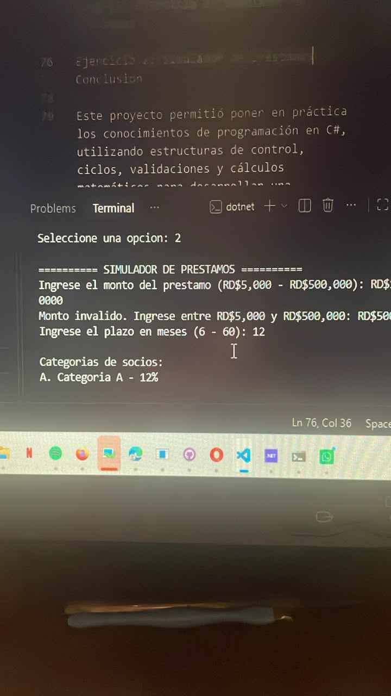

# cooperativa-ahorro-seguro
Proyecto grupal de Algoritmos Computacionales en C#.
Integrantes del grupo 11
	•	Andy Desena — 24-MISN-2-004
	•	Deiby Marte — 20-SISN-2-001
	•	Samuel Ramirez — 26-EISN-2-035
	•	Claribel Martínez Báez — 25-SISN-2-030

Docente: Gamalier Reyes del Carmen.

Descripción del proyecto

Este proyecto consiste en una aplicación de consola desarrollada en C# para la Cooperativa Ahorro Seguro. Su propósito es aplicar estructuras de control, ciclos y validaciones mediante dos ejercicios prácticos.

Ejercicio 1: Cajero automático

El cajero automático permite:
	•	Ingresar un PIN de cuatro dígitos.
	•	Bloquear la cuenta después de tres intentos incorrectos.
	•	Consultar el saldo disponible.
	•	Realizar depósitos mayores que cero.
	•	Retirar dinero respetando el saldo disponible y múltiplos de RD$100.
	•	Mostrar la cantidad de depósitos, retiros y el saldo final.

Saldo inicial: RD$10,000.

PIN de prueba: 1234.

Ejercicio 2: Simulador de préstamos

El simulador permite:
	•	Solicitar préstamos desde RD$5,000 hasta RD$500,000.
	•	Seleccionar plazos desde 6 hasta 60 meses.
	•	Elegir una categoría de socio.
	•	Calcular la cuota mensual mediante la fórmula de amortización.
	•	Mostrar una tabla de amortización.
	•	Calcular el total pagado y los intereses.
	•	Simular otro préstamo si el usuario lo desea.

Tasas de interés
	•	Categoría A: 12% anual.
	•	Categoría B: 15% anual.
	•	Categoría C: 18% anual.

Datos de entrada
	•	PIN del usuario.
	•	Opciones de los menús.
	•	Montos de depósitos y retiros.
	•	Monto del préstamo.
	•	Plazo en meses.
	•	Categoría del socio.
	•	Respuesta para repetir el préstamo.

Procesamiento

El programa utiliza estructuras condicionales y repetitivas para validar los datos, controlar las operaciones, calcular intereses y generar la tabla de amortización.

Datos de salida
	•	Saldo disponible.
	•	Confirmación de depósitos y retiros.
	•	Resumen de operaciones.
	•	Cuota mensual del préstamo.
	•	Tabla de amortización.
	•	Total pagado e intereses.

Tecnología utilizada
	•	Lenguaje de programación: C#.
	•	Plataforma: .NET 10.
	•	Editor: Visual Studio Code.
	•	Control de versiones: GitHub.

Evidencias del proyecto

Ejercicio 1: Cajero automático!  Ejercicio 2: Simulador de préstamos

Ejercicio 2: Simulador de préstamos
Conclusión

Este proyecto permitió poner en práctica los conocimientos de programación en C#, utilizando estructuras de control, ciclos, validaciones y cálculos matemáticos para desarrollar una aplicación funcional.